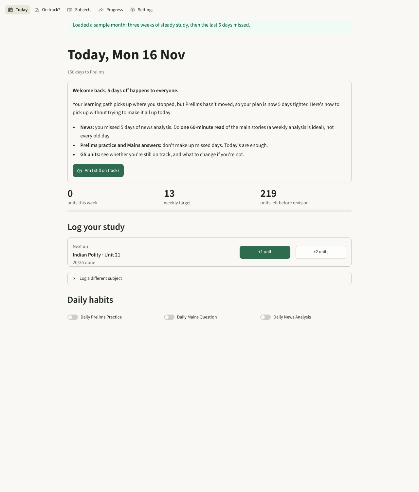

# Comeback

For my SuperKalam APM application: I used the SuperKalam app, found a problem, and built a fix.

## The problem I found

When you miss days on SuperKalam, the GS learning path just resumes where you stopped. That pushes your whole syllabus later, but Prelims doesn't move. My Progress shows units done ("0/259 units completed"), but not your pace, or whether you'll finish before Prelims at that pace. So after a bad week you can't tell whether you're fine or two months behind.

Other prep apps already show this. SuperKalam has everything it needs to show it (exam year, a fixed 259-unit path, daily progress), but it doesn't.

## What Comeback does

- Tells you in one line whether you'll finish in time, for example: "At 1.5 units a day you'd finish on 30 Apr: 21 days after Prelims, with no time to revise."
- If you're a bit behind, it raises your weekly target, within a catch-up limit you set.
- If that isn't enough, it suggests what to park: Mains-only subjects until after Prelims first, then subjects you marked "can skim". Subjects you marked "must finish" are never parked. Every suggestion has a reason and you can change it.
- After 2+ days off, a short welcome back: one news catch-up read instead of every missed day.

It uses SuperKalam's own 18 subjects and 259 units, its Mains tags and its three daily habits.

| Back after 5 days off | Behind, and the plan |
|---|---|
|  |  |

## Files

- [docs/research.md](docs/research.md): what I found in the app (with screenshots), what SuperKalam says, other apps, what I still don't know
- [docs/product.md](docs/product.md): the problem, what it does, why each rule, metrics, risks, and the validation plan (not done yet)
- [docs/tech.md](docs/tech.md): how it's built, how each user's data is kept private, and setup steps
- `screenshots/`: Comeback's screens, and `screenshots/superkalam/` from my research

## Run it

No sign-up: open the app and press **Try it with a sample month**.


1. Create a Supabase project, open SQL Editor, and run `database/setup.sql`. Then turn on **Authentication → Sign In / Providers → Allow anonymous sign-ins**.
2. Create `.streamlit/secrets.toml` with your Project URL and anon key (`SUPABASE_URL = "..."` and `SUPABASE_ANON_KEY = "..."`). On Streamlit Cloud, paste them under Settings → Secrets instead.
3. Run:
   ```bash
   pip install -r requirements.txt
   streamlit run app.py
   ```

Full steps are in [docs/tech.md](docs/tech.md).

## Built with

Python only: Streamlit for the app, Supabase for guest sessions and the Postgres database.
