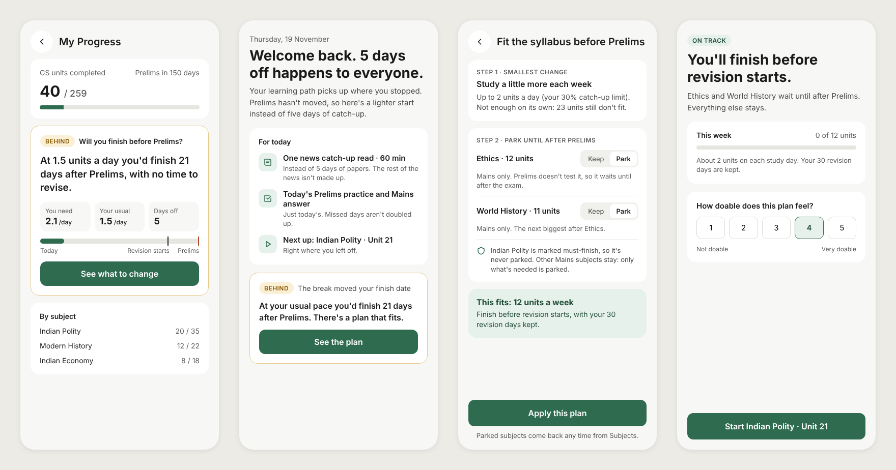
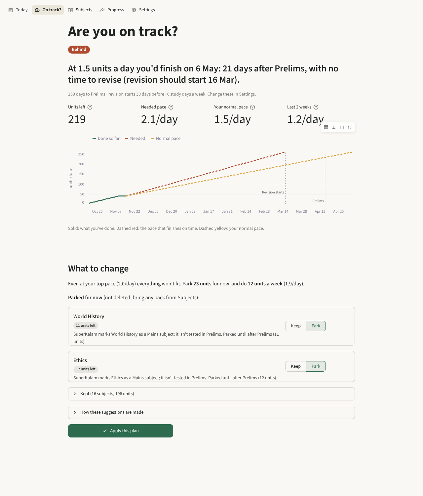

# Comeback

Live app: https://comeback-r26ckaavsdeztbi2evlbzs.streamlit.app

I built this for my SuperKalam APM application. The task was to use the app, find a problem, and build something for it.

## The problem

My first idea was wrong. I thought missing days would leave a pile of targets to catch up on, so I planned a tool to sort that pile. Then I set up targets in the app and saw there's no pile: the daily habits reset and the GS learning path just resumes where you stopped.

But that's the real problem. Resuming pushes your whole syllabus later, and Prelims doesn't move. My Progress shows "0/259 units completed", but not your pace or whether you'll finish before Prelims. So after a bad week you can't tell if you're fine or two months behind.

Other prep apps (Poro, Lighthouse Prep) already show this. SuperKalam has everything it needs (exam year, the 259-unit path, daily progress), but doesn't show it.

## What Comeback does

- Tells you in one line if you'll finish in time. For the sample month it says you'd finish 21 days after Prelims, with no time to revise.
- If you're slightly behind, it raises your weekly target, within a catch-up limit you set.
- If that's not enough, it suggests parking Mains-only subjects until after Prelims, then subjects you marked "can skim". It never touches "must finish" subjects, and you can say no to any suggestion.
- After 2+ days off, a short welcome back with one news catch-up instead of every missed day.

It uses SuperKalam's own 18 subjects, 259 units, Mains tags and three daily habits.

### How it would look inside SuperKalam

A design of the same flow as it could sit in the app: the "on track?" card on My Progress, the welcome back, the plan, and the plan applied.

### The working prototype

| Back after 5 days off | Behind, and the plan |
|---|---|
|  |  |

## More detail

- [docs/research.md](docs/research.md): what I found in the app, with screenshots
- [docs/product.md](docs/product.md): the rules and why, how I'd measure it, and how I'd test it next

Built with Python, Streamlit and Supabase.
